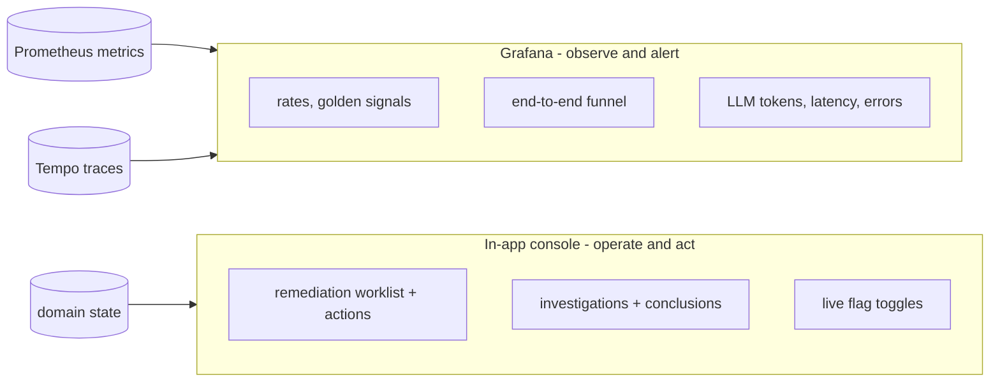

# CFOperator observability

Two purpose-scoped surfaces — **never one holistic dashboard**:

Boundary rule: **a trend or a number you'd graph/alert on → Grafana; a row you'd
read or a button you'd click → console.** Neither tries to be the other.

## Patterns applied

- **Four Golden Signals** (latency/traffic/errors/saturation) — default lens
- **RED** (rate/errors/duration) for request-like work (triage, investigations, LLM)
- **USE** (utilization/saturation/errors) for resources (fleet, queue)
- **Work-queue / Little's Law** (`L = λW`) for the remediation queue
- **Funnel / conversion** for the end-to-end agent — drop-off per stage

## Grafana (status: built)

- **`CFOperator — Remediation`** (`cfop-remediation.json`, homelab-infra) — work-queue
  pattern (depth by status, arrival λ by source/class, outcomes μ, executor spawns,
  reaper) **+ the end-to-end funnel** (alerts → triage→investigate → investigations
  → needs_action → queued → auto-eligible → resolved) + a Loki logs panel.
- **`CFOperator Fleet Monitoring`** (`cfoperator-dashboard.json`, the former
  66-panel board) — slimmed; bolted-on remediation tiles removed. It and the
  `CFOperator Event Runtime` board are mirrored byte-for-byte in this repo's
  [grafana/](../grafana/README.md).
- Datasources are picked by dashboard variables (`${datasource}`, `${loki}`),
  not pinned uids; the provisioned Prometheus and Loki datasources have no uid
  on purpose (homelab-infra's `datasources.yaml` says why). Boards are
  ConfigMaps generated in `k3s/base/monitoring/kustomization.yml` from
  `files/grafana-dashboards/`, mounted into Grafana, and re-read by its file
  provider every 30 seconds; there is no sidecar.

**Built 2026-09-04 (CFOP-163 / HOMELAB-17):** the LLM & Triage drilldown
(`CFOperator — LLM & Triage`, provisioned from homelab-infra alongside the
event-runtime board that had been written but never provisioned). The audit
that produced it found triage entirely uninstrumented and the stack's LLM
alerts pointed at a metric prefix nothing emits; the metrics it charts were
added in CFOP-163. A separate top-level Overview board remains unbuilt.

**Built 2026-10-14 (HOMELAB-37):** `CFOperator — Traces`, from the span metrics
Tempo derives from cfoperator's traces: runs by kind and their duration, where
a sweep's time goes by phase, LLM call and tool latency by name, and runs that
failed or were cut short by a deploy, with exemplar links from Prometheus
panels to the trace. What the spans contain is in
[llm-observability.md](llm-observability.md#tracing-opentelemetry-opt-in).

## In-app console (status: built, `:8083`)

- **`/remediations`** — worklist (open items up top, **Closed (resolved/rejected)
  below a divider**), status/risk badges, detail drawer with the proposed diff/PR;
  actions: approve / resolve (manual close + note) / reject / reclassify
  (class·risk·repo); pipeline bar with live
  `feed/drain/reap/verify/tracker/re-verify/node-action` toggles + run
  feed-summary; toasts, click-away dismiss.
- **`/investigations`** — outcome-filtered list + drill into each one's
  recommendation/findings (read what the agent concluded), and the Explain
  view of the steps it took to get there (CFOP-324).
- **`/events`** (CFOP-215) — every alert the event runtime received and what it
  decided, including the ones triaged to `log_only`/`notify`, suppressed or
  gated, which never become investigations. Filter by status, decision, source,
  severity, time window and text (kept in the URL); page with "load older";
  the drawer shows the triage reasoning, the outcome, the event timeline and a
  link to the investigation it caused. Read through `/api/events`, a proxy to
  the runtime's `/v1/alerts` read model.
- All theme-matched to the main UI; logo links home; cross-linked.

## Metrics

Emitted by the agent (the `agent/` package, served on `:8083/metrics`) and the
event runtime (`event_runtime/telemetry.py`, on its own port). Labels, their
values and example queries are in [METRICS.md](METRICS.md); this table is only
which signal answers which question.

| metric | use |
|---|---|
| `cfoperator_remediation_queue{status}` | queue depth (gauge) |
| `cfoperator_remediation_enqueued_total{source,remediation_class,eligible}` | arrival rate λ |
| `cfoperator_remediation_executor_spawned_total{result}` | drain activity |
| `cfoperator_remediation_outcome_total{outcome}` | terminal outcomes μ |
| `cfoperator_remediation_reaped_total` | dead-lease recoveries |
| `cfoperator_investigations_total{outcome}` | investigation funnel stage |
| `cfoperator_event_runtime_alerts_received_total` / `decisions_total{action}` | funnel head |
| `cfoperator_llm_*` | LLM RED + cost |

Reading domain state: use the console / read APIs (`GET /api/remediations`,
`GET /api/investigations`, `GET /api/events`) — not psql.
